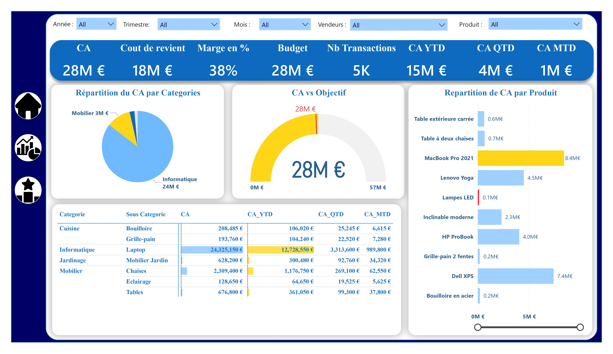
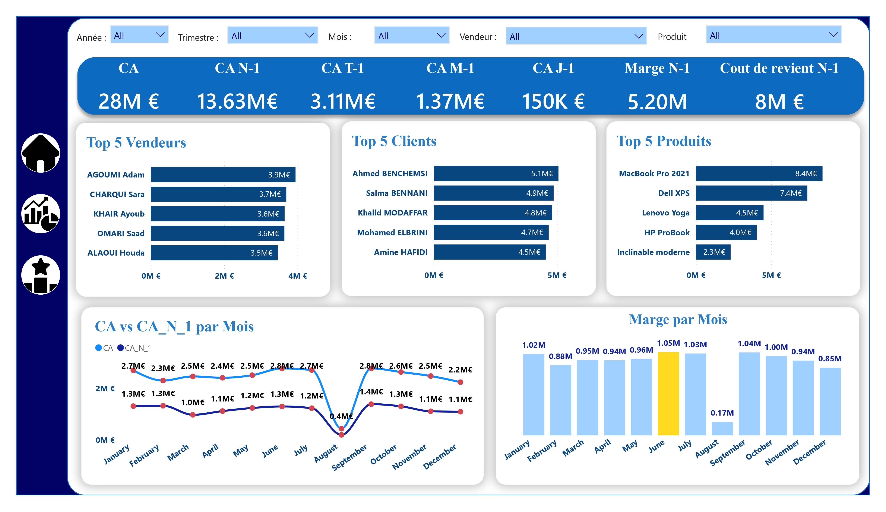
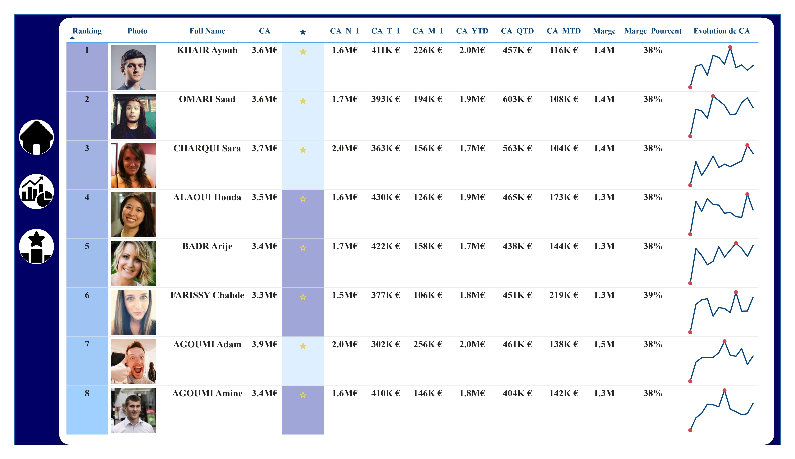

# Sales Performance Analytics

Interactive Power BI dashboard for analyzing sales performance, profitability, targets, customer and product performance, and salesperson activity.

## Project Overview

This project presents an interactive Power BI dashboard designed to provide a comprehensive view of sales and financial performance.

The dashboard is organized into three main analytical views:

- **Sales Performance Overview**
- **Sales Performance Analysis**
- **Salesperson Performance**

These views allow users to analyze revenue, costs, margins, budgets, transactions, sales trends, top-performing products and customers, and salesperson performance through interactive visualizations.

## Business Objectives

The main objectives of this dashboard are to:

- Monitor overall sales performance.
- Analyze revenue and cost performance.
- Track profit margins.
- Compare sales against budget and objectives.
- Analyze sales performance over different time periods.
- Identify top-performing salespeople.
- Identify top-performing customers and products.
- Analyze sales evolution over time.
- Compare current performance with previous periods.

## Key Performance Indicators

The dashboard provides several key performance indicators, including:

- **Revenue (CA):** €28M
- **Cost of Goods:** €18M
- **Margin:** 38%
- **Budget:** €28M
- **Transactions:** 5K
- **YTD Revenue:** €15M
- **QTD Revenue:** €4M
- **MTD Revenue:** €1M

## Sales & Financial Analysis

The dashboard provides insights into:

- Total revenue.
- Cost of goods.
- Profit margin.
- Revenue versus budget.
- Revenue versus objectives.
- Sales by category.
- Sales by product.
- Monthly revenue evolution.
- Margin evolution over time.

The dashboard also provides comparisons with previous periods to help analyze changes in business performance.

## Time-Based Analysis

Sales performance can be analyzed across multiple time periods, including:

- Year-to-Date (YTD)
- Quarter-to-Date (QTD)
- Month-to-Date (MTD)
- Previous year
- Previous quarter
- Previous month
- Previous day

This allows users to compare current performance with historical periods and identify changes in sales activity.

## Top Performance Analysis

The dashboard highlights top-performing business elements through rankings such as:

- Top 5 salespeople.
- Top 5 customers.
- Top 5 products.

## Salesperson Performance

The Salesperson Performance view provides a detailed analysis of individual salesperson activity.

It includes:

- Salesperson ranking.
- Revenue generated.
- Previous-period revenue.
- YTD revenue.
- QTD revenue.
- MTD revenue.
- Margin.
- Margin percentage.
- Revenue evolution.

## Sales Evolution

The dashboard provides temporal visualizations to analyze:

- Monthly revenue.
- Revenue compared with the previous year.
- Monthly margin.
- Revenue evolution.
- Performance against objectives.

## Data Source

This Power BI project uses a **SQL Server database** as its data source.

The current model is connected to the SQL Server database:

```text
Database: Perfo
```

The Power BI model contains the following main tables:

- `Dim_Categorie`
- `Dim_Client`
- `Dim_Produit`
- `Dim_Sous_Categorie`
- `Dim_Temps`
- `Dim_Vendeur`
- `Fact_Budget`
- `Fact_Ventes`

The database connection is currently configured through SQL Server and is not packaged as CSV files inside this repository.

## Tools & Technologies

- **Microsoft Power BI**
- **SQL Server**
- **Power Query**
- **DAX**
- **Data Modeling**
- **Data Visualization**
- **Time Intelligence**

## Dashboard Preview

### Sales Performance Overview



### Sales Performance Analysis



### Salesperson Performance



## Project Structure

```text
sales-performance-analytics/
│
├── PowerBI/
│   └── Sales_Performance_Analytics.pbix
│
├── screenshots/
│   ├── Sales_Performance_Analytics-1.jpg
│   ├── Sales_Performance_Analytics-2.jpg
│   └── Sales_Performance_Analytics-3.jpg
│
├── Sales_Performance_Analytics.pdf
│
└── README.md
```

## Key Insights

The dashboard makes it possible to analyze:

- Overall revenue and profitability.
- Sales performance against budget and objectives.
- Revenue and margin evolution over time.
- Top-performing salespeople.
- Top-performing customers.
- Top-performing products.
- Current performance compared with previous periods.
- Individual salesperson performance and rankings.

## Project Context

This project was developed as part of my practical work in Data Analytics using Microsoft Power BI.

## Author

**Abderrahman El Harakani**

Master's Student in Data Science  
Data Analytics

[LinkedIn](https://shorturl.at/nfMqM)
